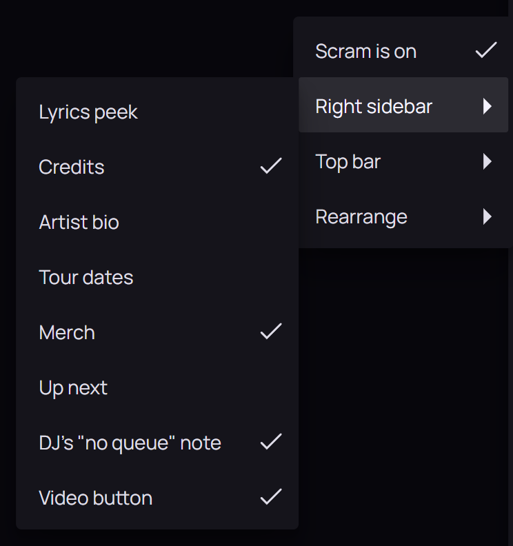

# Scram

*scram*

Spotify's now playing panel keeps accumulating sections and there's no setting for any of them. This
adds one. Ten, actually.

<p align="center">
  
</p>

## What's in it

Everything's under **Scram** in the Spicetify menu, behind your profile picture. Tick something and
it's gone, no restart.

| Group | Toggles |
|---|---|
| Right sidebar | Lyrics peek, Credits, Artist bio, Tour dates, Merch, Up next, DJ's "no queue" note, Video button |
| Top bar | Studio button |
| Rearrange | Small cover (85px, with the title beside it) |

**Scram is on** turns it all off and back on without losing your picks.

## Install

Marketplace: search "Scram" under Extensions.

Or drop `hide-ui-elements.js` in `%APPDATA%\spicetify\Extensions`
(`~/.config/spicetify/Extensions` on Linux and macOS) and run:

```
spicetify config extensions hide-ui-elements.js
spicetify apply
```

Needs `:has()`. Tested on Spotify 1.3.8 and Spicetify 2.46.4.

## Adding your own

`GROUPS` is at the top of the file. A row adds a toggle, a group adds a submenu, and the comments
say what each selector keys off.

```js
{ id: "merch", label: "Merch", selector: `${PANEL} > div > div:has(a[href*="shop.spotify.com"])` },
```

## Also

`snippets/` has CSS repairs for Marketplace snippets that broke on Spotify 1.3.x.
[RELEASE.md](RELEASE.md) covers commits and versioning, and [CHANGELOG.md](CHANGELOG.md) has the history.

## License

MIT. Hide whatever you like.
